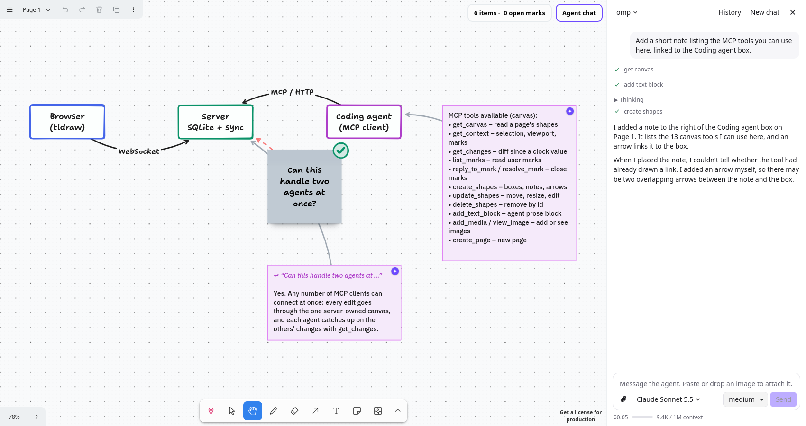

# duet-canvas

A local tldraw canvas that you use in the browser **and** your coding agent edits over MCP.
The server owns the canvas (SQLite), so the agent can read and edit it with the browser closed.

Any MCP client (Claude Code, omp, ...) can connect to it. The web app also has a built-in chat panel that drives [omp](https://github.com/can1357/oh-my-pi), Claude Code, Codex, opencode or pi, whichever you pick. You draw, mark things you want help with, and the agent answers next to them on the canvas.

Status: early (0.1). Expect rough edges. It is a local, single-user tool.

<p align="center"></p>

<p align="center"></p>

## Requirements

- Node.js 24 (the server runs TypeScript directly) and pnpm 12.
- Optional: one or more of [omp](https://github.com/can1357/oh-my-pi), [Claude Code](https://code.claude.com), [Codex](https://github.com/openai/codex), [opencode](https://opencode.ai) or [pi](https://github.com/earendil-works/pi) on your `PATH`, each already signed in, for the in-app chat. Not needed if you only connect an MCP client.
- Optional: Docker, to run the server without Node.

## Run

```sh
git clone https://github.com/nielpattin/duet-canvas.git && cd duet-canvas
pnpm install
pnpm dev          # web http://localhost:5173 (use this one), server on :5858
# or production-style:
pnpm build && pnpm start   # everything on http://localhost:5858
# or Docker:
docker compose up --build
```

## Agent chat (native only)

The web app has an **Agent chat** panel that drives your own agent CLI. The agent's name at the top left of the panel is a dropdown: pick omp, Claude Code, Codex, opencode or pi (CLIs that are not found are listed greyed out). Each must be on your `PATH`, or set `OMP_BIN`, `CLAUDE_BIN`, `CODEX_BIN`, `OPENCODE_BIN`, `PI_BIN`. The server starts the CLI on first use; the choice, and each agent's last model and effort, are remembered.

<p align="center"></p>

The chat socket is `/chat?token`. Claude Code runs one process per turn; pi speaks the same JSONL RPC as omp.

**Sign-in stays with each CLI.** This app never reads, stores or forwards their credentials: sign in yourself (`claude login`, `codex login`, `opencode auth login`, `pi auth login`) and the CLI uses its own. That is also what the vendors' terms require: Claude Code must run unmodified with the user's own login, and Codex's app-server sign-in is for local use only, never for a hosted service. Do not host this chat for other people.

### Run it with the CLI

```sh
pnpm add -g .            # once, from this repo: puts `duet-canvas` on your PATH (pnpm 12 has no `link --global`)
duet-canvas              # start in the foreground and print the unlock link
duet-canvas start -d     # run in the background (log: <data dir>/duet-canvas.log)
duet-canvas status | stop | url | token | rotate
duet-canvas start --port 5859 --data-dir D:\canvas
```

`start` builds `web/dist` if it is missing and prints a link ending in `?chat=<token>`. Open that link once (or paste it, or the bare `duet-canvas token`, into the locked chat panel) and the server gives the browser an HttpOnly cookie. Cookies ignore the port, so one unlock also covers the Vite dev server on the same host (`localhost` and `127.0.0.1` count as different hosts). Without it the chat shows "locked" and `/chat` refuses the socket. The token lives in `<data dir>/chat-token`.

**If the token or its link leaks** (a screenshot, a shared terminal or log), run `duet-canvas rotate`. It writes a new token; the running server reads the file on every check, so the old token stops working at once without a restart: old links, browsers' saved unlock and open chats are cut (the panel shows "locked" until you open the new link, which `duet-canvas url` prints again). Deleting `<data dir>/chat-token` by hand does the same. `start -d` keeps the token out of `duet-canvas.log` (run `duet-canvas url` for the link); entries from older versions are dead after a rotate.

### What it does

- **Docker has no chat.** A container cannot see your omp, so the button is hidden there (the image sets `CANVAS_DOCKER=1`). Docker stays the way to give MCP clients the canvas.
- **The chat agent only has the canvas tools, as far as each CLI allows.**
  - omp runs with `--no-tools`, `tools.xdev: false`, no extensions/skills/rules/context files, and `--yolo`: no bash, edit, eval or filesystem access. Servers from your own `~/.omp/agent/mcp.json` are switched off for the chat (a project-level `enabled: false` stub per name); a warning shows if any other tool still gets through.
  - Claude Code runs with `--tools ""`, only the canvas MCP server (`--strict-mcp-config`), no user settings, CLAUDE.md files or memory.
  - opencode runs a `canvas` agent (project config in the workspace) that denies every tool except the canvas MCP server's. Your own global opencode instructions and plugins still load.
  - pi runs with no built-in tools, no extensions except its built-in MCP, no skills, prompt templates or context files, and the canvas MCP server only; its own MCP servers from `~/.pi/agent/mcp.json` are switched off for the chat, and an empty project `APPEND_SYSTEM.md` keeps your global one out of the prompt. A message restored by Esc comes back without its images, and a queue edit clears and re-queues the whole queue.
  - Codex cannot drop its own shell and file tools. It runs with a read-only sandbox and nothing is ever approved; your own MCP servers from `~/.codex/config.toml` still load.
- **Keys** (same as omp): Enter sends, and steers a running agent; Alt+Enter queues a follow-up for after the run; Esc stops (queued text returns to the box). Queued messages show as chips. omp, pi and Codex deliver a steer inside the running turn; Claude Code and opencode run it as soon as the turn ends, before follow-ups.
- **Model and effort** come from the agent (Claude Code: opus, sonnet, haiku or its default). The picker shows one provider at a time with a search across all. Changing either mid-chat keeps the same chat; the provider's prompt cache restarts for that turn.
- **Images:** attach, paste or drop (PNG, JPEG, GIF, WebP, up to 6, shrunk to 2000px).
- **Cost and context** of the current chat show under the box (spend, tokens in context; the bar turns amber, then red).
- **Chats** are omp sessions in `<data dir>/sessions`; for the other agents the transcript is a JSON file there and the agent's own session is resumed. **History** lists the chats of the selected agent and reopens them; **New chat** starts a new session and keeps the old file. Long chats render the newest 30 messages and load more as you scroll up.
- **Marks:** Ctrl+M marks the selection, Shift+M jumps to the next open mark, **Ask agent** (pill and context menu) prompts the agent, **Clear answered marks** tidies up.
- The panel follows tldraw's light/dark/system theme.

## Connect your agent

**omp:** add the server to `.omp/mcp.json` in your project, or to `~/.omp/agent/mcp.json` to have it everywhere. This repo already ships the project-level file, so omp started here just works.

```json
{
  "mcpServers": {
    "duet-canvas": { "type": "http", "url": "http://127.0.0.1:5858/mcp", "enabled": true }
  }
}
```

**Claude Code:**

```sh
claude mcp add --transport http duet-canvas http://localhost:5858/mcp
```

**Codex:**

```sh
codex mcp add duet-canvas --url http://localhost:5858/mcp
```

**OpenCode:** add this to `opencode.json` in your project (or your global OpenCode config):

```json
{
  "mcp": {
    "duet-canvas": { "type": "remote", "url": "http://localhost:5858/mcp", "enabled": true }
  }
}
```

Any other MCP client that speaks streamable HTTP works with the same URL.

Tools: `get_context`, `get_canvas` (one page at a time), `get_changes`, `list_marks`, `reply_to_mark`, `resolve_mark`,
`add_text_block`, `create_page`, `create_shapes`, `update_shapes`, `delete_shapes`, `view_image`, `add_media`.

`add_media` takes PNG, JPEG, GIF, WebP, MP4 or WebM from a local `path`, a `url` (the server downloads it) or `base64`.
Sample files to try it with are in `examples/media/`. Only images can be *viewed* by the agent (`view_image`).

**Seeing the canvas:** the agent works from data only. `get_canvas` returns types, positions, sizes, text, colors and arrow bindings; there is no render or screenshot tool, so no browser tab is needed for the agent to work.

**Staying in sync:** every read is live, and every result ends with `canvas.clock` and `canvas.openMarks`. The agent
passes its last clock to `get_changes` to see what the user added, edited, moved or deleted since.
The server also sends usage instructions to the agent on connect (see `INSTRUCTIONS` in `server/src/mcp.ts`).

## Talking to the agent: marks

Pick the **Mark** tool in the toolbar (pin icon, key `m`) and click any shape, picture or agent block: a pink note opens
attached to it with a dashed arrow. Click empty canvas for a free note. The agent reads open marks, answers with a violet
block placed next to the mark, and marks it answered (dimmed). Editing an answered mark reopens it. The top-right pill
shows `N items · M open marks`.

To mark several shapes at once, select them, right-click and choose **Mark selection**. A dashed pink box is drawn around the selection and one arrow joins the note to it. The box follows the shapes when you move them. When the agent answers, the box turns violet and the answer arrow points at it. `list_marks` returns the box as `selection` (x, y, w, h).

To give feedback on an answer, click the violet box (its border) or the agent's reply, then choose **Mark selection** (or use the Mark tool on the reply). Feedback on the box reuses it: the box turns pink again until the agent answers. The box cannot be moved by hand; it always wraps its shapes. `list_marks` adds `thread` (what you wrote, what the agent answered, and the box, oldest first) so the agent sees the earlier turns.

Everything the agent creates has `meta.author = 'agent'`. Its text blocks wear a small purple spark icon in the corner and its pictures
have one before the caption, so you can tell its words and media from yours. Diagram shapes and arrows are not badged. New content is auto-placed in free space so it never overlaps existing shapes.

## Media cards

Pictures, GIFs and videos are one shape (`media-card`): the media plus an editable caption that always moves, resizes and
deletes with it. Pictures you drop or paste are turned into cards too. Double-click a card (or press Enter) to edit its caption.
The shape is defined twice, in `server/src/mediaCard.ts` and `web/src/mediaCard.tsx`: keep them in sync.

## Data

Your OS data dir, or `DATA_DIR` (`/data` in Docker): `canvas.db` (document), `ui-context.json` (last selection/viewport), `uploads/`, and for the chat `sessions/` and `workspace/`.
The default is `%APPDATA%\duet-canvas` on Windows, `~/Library/Application Support/duet-canvas` on macOS and `$XDG_DATA_HOME` (or `~/.local/share`)`/duet-canvas` on Linux. Before the rename from canvas-idea the folder was called `canvas-idea`: if it exists and `duet-canvas` does not, it is still used. It used to be `.data/` next to where you ran the server: move it over to keep an old canvas.

## Security

Binds to 127.0.0.1 and rejects unknown `Host` headers and cross-origin requests. Extra hosts: `ALLOWED_HOSTS=a.local,b.local`.

- **The MCP endpoint (`/mcp`) and the canvas have no auth.** Anyone who can reach the port can read and edit the canvas. Do not expose it beyond localhost without putting authentication in front of it (the Docker compose file publishes the port on loopback only).
- **The chat is protected by a token** (see above), because it drives an agent on your machine. Never share the unlock link; run `duet-canvas rotate` if it leaks.
- The chat agent runs with `--yolo` but only has the canvas tools. Your own omp MCP servers are switched off for it.

## Development

```sh
pnpm typecheck                 # all packages
pnpm --filter server test      # server unit tests
pnpm --filter web build        # rebuild web/dist (the server serves the built files)
```

`server/` is the Hono + MCP + tldraw sync server, `web/` is the Vite/React app, `bin/` is the `duet-canvas` CLI.

## License

duet-canvas is [MIT](LICENSE).

[tldraw](https://tldraw.dev), which it is built on, is not open source and has its own license. Its SDK needs a license for production use; without a key it shows a "Made with tldraw" watermark. See the [tldraw license](https://github.com/tldraw/tldraw/blob/main/LICENSE.md) before you deploy this or build on it. This repo does not include a tldraw license key.
